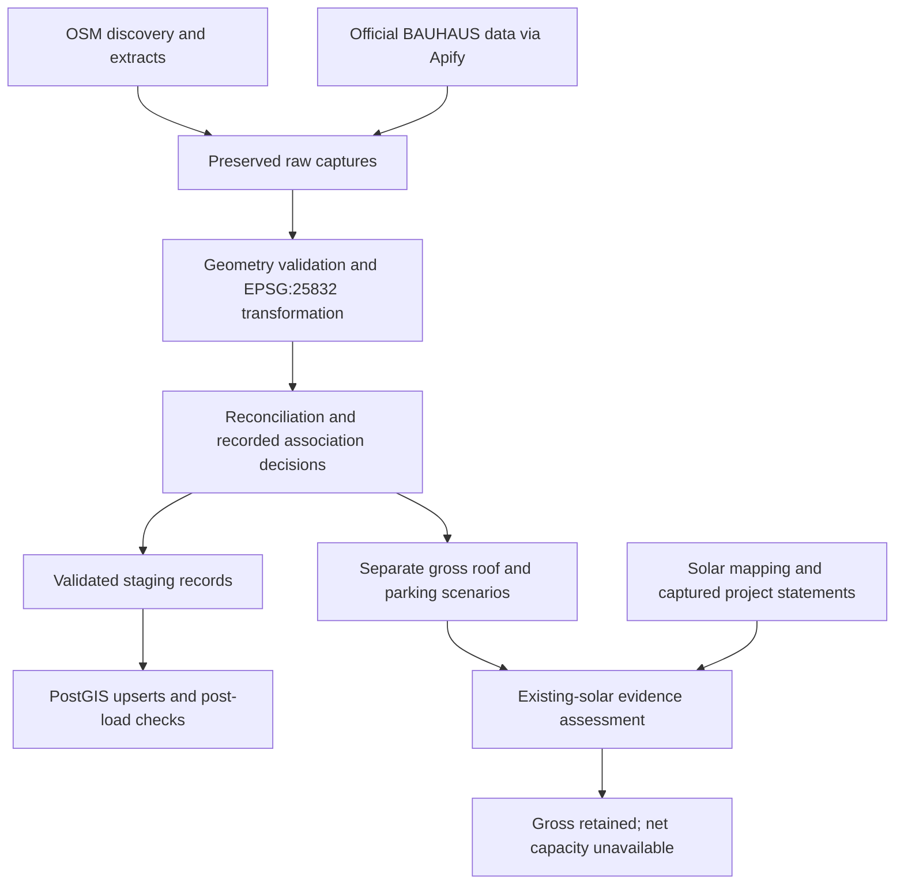

# Project IRIS — TASK-CRE-33

**BAUHAUS Germany: spatial ingestion, reconciliation and PostGIS staging for preliminary PV screening**

This project combines official BAUHAUS store information with OpenStreetMap building and parking geometry. Python workflows preserve source evidence, validate and transform polygons, reconcile facility associations, calculate illustrative PV scenarios and load classified features into PostgreSQL/PostGIS staging.

All analysis polygons and staged geometries use **EPSG:25832**. **National inventory completeness remains unverified.** Capacity figures are preliminary screening scenarios; installation feasibility and net additional capacity are not established.

## Contents

- [1. Strategy and scope](#1-strategy-and-scope)
- [2. Pipeline architecture](#2-pipeline-architecture)
- [3. Findings and inventory](#3-findings-and-inventory)
  - [3.3 Extended findings and analysis](#33-extended-findings-and-analysis)
- [4. Ingestion and source evidence](#4-ingestion-and-source-evidence)
- [5. Validation, transformation and reconciliation](#5-validation-transformation-and-reconciliation)
- [6. Capacity calculations](#6-capacity-calculations)
- [7. Existing-solar assessment](#7-existing-solar-assessment)
- [8. Database model and loading](#8-database-model-and-loading)
- [9. Reproducible execution](#9-reproducible-execution)
- [10. Quality assurance and validation evidence](#10-quality-assurance-and-validation-evidence)
- [11. Implementation map and reproducibility boundaries](#11-implementation-map-and-reproducibility-boundaries)
- [12. Limitations](#12-limitations)
- [13. Sources and attribution](#13-sources-and-attribution)

## 1. Strategy and scope

### 1.1 Geometry-led screening

The capacity model requires eligible area derived from usable polygons. The workflow therefore begins with OSM-led discovery of locations and geometry candidates, followed by official BAUHAUS evidence for identity and location reconciliation. This prioritizes geometry relevant to the calculation and uses bounded acquisition and cached evidence.

In the implemented workflow, OSM locations also supplied postcode seeds for official locator queries. Those queries returned facilities independently of whether a building polygon was ultimately selected. Identified facilities without usable geometry remain in the reconciliation inventory with unavailable estimates.

Geometry validity and BAUHAUS association are separate checks. A valid polygon is not sufficient evidence of the correct retailer, ownership or installation rights. Other retailers do not qualify for BAUHAUS parking scenarios.

### 1.2 Coverage boundary

OSM-led discovery creates dependence on mapped candidate coverage. Collecting every chosen seed or matching every collected record does not establish an exhaustive national inventory. Official locator, sitemap and OSM differences are retained and investigated; unresolved gaps prevent a national-completeness claim.

The database retains the broader acquisition inventory with evidence classifications. Published capacity scenarios use narrower qualifying subsets. Roof and parking eligibility are assessed separately, although the implemented parking search depends on selected building candidates and can omit parking where building geometry is unresolved.

## 2. Pipeline architecture



The diagram shows the data dependencies. Some historical consolidation and association decisions were produced through development scripts or terminal steps. The packaged staging pipeline consumes those recorded decisions; complete automated raw-source-to-final-decision execution is not claimed.

## 3. Findings and inventory

The accepted rooftop subset has an illustrative gross capacity of **119.94 MWp**. Provisional rooftop estimates are retained separately. The current parking scenarios cover **275,049.82 m²** across **34 qualifying polygons**, with a conditional central capacity of **12.502 MWp** and a sensitivity range of **7.501–15.003 MWp**.

These are assessed-subset results. Roof and parking totals are separate; net additional capacity is unavailable because existing-solar coverage has not been established.

### 3.1 Official store inventory

The collected locator responses contain **161 distinct official BAUHAUS store IDs**.

| Building-association outcome | Official stores |
| --- | ---: |
| Accepted screening association | 86 |
| Provisional association | 21 |
| Parking structure requiring review | 2 |
| No selected containing building | 52 |
| **Total** | **161** |

“Accepted” refers to the recorded screening association between a store and a building polygon. It does not establish ownership, exclusive roof rights or installation feasibility.

The 52 stores without selected building geometry remain in the reconciliation reports with unavailable capacity.

### 3.2 Staging inventory

| Feature | Association status | Records |
| --- | --- | ---: |
| Building | `accepted_screening_association` | 86 |
| Building | `provisional_association` | 21 |
| Building | `parking_structure_review` | 2 |
| Building | `unmatched_osm_candidate` | 63 |
| Parking | `unverified_operator` | 329 |
| Parking | `unverified_proximity` | 808 |
| **Total** | | **1,309** |

The 172 building polygons comprise 167 consolidated OSM candidates and five additional cached geometry candidates. The 63 unmatched building candidates are not additional confirmed stores.

The 1,137 parking polygons form an acquisition and audit inventory. They are not all attributed to BAUHAUS. Only 34 polygons qualify for the separate parking-capacity scenarios.

### 3.3 Extended findings and analysis

#### 3.3.1 Association evidence and investigation opportunities

The 161 identified facilities provide the denominator for building-association outcomes. The 52 facilities without selected geometry retain unknown area and capacity. Their absence from the capacity aggregates represents an evidence gap, not zero physical potential.

The 21 provisional associations retain separate illustrative rooftop estimates. The two parking-structure reviews remain outside rooftop estimates. These cases require different follow-up: association review for provisional records and component/type review for parking structures.

The inventory also contains 63 building polygons without a selected official-store association. Of these, 54 carry at least one of `name`, `brand`, `operator`, `brand:wikidata` or `operator:wikidata`. This identifies available attributes, not verified BAUHAUS identity. Unmatched polygons cannot collectively be described as untagged or counted as additional confirmed facilities.

#### 3.3.2 Separate roof and parking assessment

An accepted building association does not establish parking ownership or exclusive use. Missing building geometry does not establish that a facility lacks parking. The current parking workflow depends partly on selected building candidates, so unresolved building coverage also limits parking discovery and attribution.

Of the 34 parking polygons included in conditional scenarios, 25 are near accepted building associations and nine are near provisional associations. All remain unverified parking associations; passing the scenario filters does not establish installation rights or feasibility.

Another 881 parking polygons lack explicit BAUHAUS identity. Of these, 436 have at least one recorded candidate-store link. Those links provide an investigation queue, but the linked polygons remain excluded from BAUHAUS capacity scenarios. The remaining 445 have no recorded candidate-store link. Conflicting identities, ambiguous shared use and explicit BAUHAUS candidates without selected-store links remain traceable in the detailed parking report.

These observations describe existing report classifications. They do not introduce a new acceptance rule or assign new reporting categories.

#### 3.3.3 Capacity sensitivity and interpretation

Accepted rooftop associations produce approximately 119.94 MWp of gross illustrative capacity. Provisional rooftop associations contribute a separate conditional estimate of approximately 26.12 MWp. Both use the rooftop assumptions documented in section 6.1; neither represents measured installation capacity.

The parking sensitivity scenarios hold the 34-polygon asset set and 275,049.82 m² eligible union area constant. Varying the assumed bay share from 30% to 60%, while retaining 50% canopy coverage of bays and 5.5 m²/kWp, produces 7.501–15.003 MWp. The central scenario is 12.502 MWp.

This range measures sensitivity to an assumed coverage fraction. It is not a statistical confidence interval and does not quantify uncertainty in identity, geometry, shading, structure or installation rights. Rooftop and parking estimates remain separately reported.

#### 3.3.4 Existing solar and additional potential

The solar search covered 141 selected assets and returned eight unique solar-tagged OSM objects. None intersected the selected estimate geometries. External sources nevertheless document rooftop PV at Stuttgart-Untertürkheim and Wiesbaden/Mainz-Kastel. These positive examples demonstrate why absent intersecting OSM mapping cannot establish absent installations; Wiesbaden was outside the selected solar search because its building geometry was unavailable.

Stuttgart has a reported installed capacity of 589.05 kWp, but the retained evidence does not establish occupied roof area. Wiesbaden lacks selected building geometry and a supported numerical installation capacity in the retained evidence. No supported solar-area deduction was available, so numerical net additional capacity remains unavailable.

The retained solar assessment references the historical parking report. It was not regenerated against the revised 5.5 m²/kWp report. Source captures, extracted claims and the snapshot boundary are documented in section 7.

#### 3.3.5 Coverage implications and follow-up priorities

Investigation priorities are missing building geometry, provisional associations, parking with candidate-store links but no explicit BAUHAUS identity, shared-use questions and documented existing installations. Review can resolve either false-positive candidates or genuine facilities withheld by incomplete evidence.

The source inventories, selected associations and capacity-eligible subsets have different denominators. Candidate polygons are not additional confirmed facilities, and excluded audit areas are not BAUHAUS-attributed areas. Nationwide completeness remains unresolved. Missing geometry and absent solar mapping are retained as unknowns rather than converted to zero area or zero installed capacity.

## 4. Ingestion and source evidence

### 4.1 OpenStreetMap discovery

The initial Overpass query searches Germany for `shop=doityourself` and BAUHAUS brand/name matches.

Name matching broadens discovery but can return unrelated businesses. Search hits therefore remain candidates until reconciled with additional evidence.

### 4.2 Official BAUHAUS retrieval through Apify

Direct scripted requests encountered HTTP 403 security responses. Official source responses were subsequently captured through the third-party `apify/web-fetch` service.

Observed interfaces:

- Postcode search: `https://www.bauhaus.info/api/stores?q=<postcode>`
- Coordinate search: `https://www.bauhaus.info/api/stores-search?lat=<lat>&lng=<lng>&user_lat=undefined&user_lng=undefined`
- Store sitemap: `https://www.bauhaus.info/sitemaps/stores-de-0.xml`

The postcode collection used 156 OSM-derived seeds and returned 704 observations covering 159 distinct official IDs. Three coordinate captures added Bremerhaven and Aschaffenburg, producing the combined 161-ID inventory.

The store sitemap contains 180 distinct IDs. All 161 collected official IDs appear in it. Of the remaining 19 sitemap URLs, eight returned source HTTP 404 and eleven ended in provider timeouts. Their facility status remains unresolved.

Kretzschau also remains unresolved. Its absence from collected locator results and an unavailable store page do not establish closure.

Captures retain source responses, request metadata, timestamps and hashes where recorded. Acquisition code distinguishes provider success from source status/content validation. Locator retries are bounded and restricted to classified failures; unknown outcomes remain available for inspection.

Live acquisition is separate from the default packaged-data workflow and requires its own service configuration and allowance.

### 4.3 Parking acquisition and deduplication

The parking inventory combines:

- 339 eligible Cologne surface-parking ways.
- 808 nationwide proximity candidates.
- Ten overlapping OSM identities, counted once.

The original nationwide discovery searches within 150 m of the 167 consolidated building candidates and records 867 building–parking candidate pairs.

Acquisition classifications are preserved in staging. Eligibility for parking PV is determined separately by the stricter identity-screening model.

### 4.4 Raw evidence and provenance

| Layer | Contents | Main locations |
| --- | --- | --- |
| Raw | Official responses, OSM extracts, solar query responses and saved source pages | `data/raw/` |
| Processed | Consolidated polygons, association decisions and capacity scenario reports | `data/processed/` |
| Reference | Extracted external solar claims linked to saved-page paths and hashes | `data/reference/` |
| Reports | Integrity checks, database verification and existing-solar assessments | `data/reports/` |

Recorded hashes support detection of changed inputs. Retrieval timestamps and OSM snapshot timestamps establish when evidence was captured, not necessarily when the underlying facts last changed.

The solar collector uses bounded sequential requests, preserves failed attempts, validates terminal response counts and required members, and reuses hash-checked validated batches. Server failures and interrupted responses remain unresolved rather than being interpreted as empty results. The collector has no automatic retries; retry attempts used during acquisition are retained in the batch evidence.

## 5. Validation, transformation and reconciliation

### 5.1 Geometry processing

Building polygons are assembled from preserved Overpass responses and OSM map extracts. Way processing requires complete closed boundaries. The locator-discovery assembler also supports multipolygon relations, joined outer boundaries and inner holes.

Source longitude/latitude coordinates are transformed with `always_xy=True`. Polygon analysis and persistence use EPSG:25832.

`geometry.py` applies `shapely.make_valid()` to invalid polygon input. Other parsing paths reject incomplete or unsupported geometry. Loaders reject empty, invalid or non-polygonal geometries.

A store point provides location evidence but no roof area. Missing boundaries and missing relation members remain geometry failures. The mapped footprint represents horizontal plan area, not measured roof surface or structurally usable panel area.

### 5.2 Identity and association decisions

Recorded decisions distinguish address-supported screening associations, provisional evidence, parking structures and unresolved geometry.

The final building loader checks the selected geometry identities, decision/report consistency, input hashes, geometry areas and calculated capacity values. Unaccepted capacities remain NULL in the main staging column.

Official store IDs and OSM object identities serve different purposes: store IDs identify facilities; OSM type/ID pairs identify mapped objects. Unmatched building polygons remain candidates rather than becoming additional confirmed stores.

### 5.3 Input contracts and reconciliation checks

Before loading, the pipeline validates recorded input hashes, selected geometry identities, decision/report agreement, official-record retention, geometry areas and PV values. Duplicate or multiply allocated selected building polygons are rejected. Parking identities are deduplicated with nationwide input taking precedence over duplicate Cologne records.

Geometric overlap is checked before scenario aggregation. Rooftop accepted/provisional estimates are kept separate; parking uses a union of eligible surfaces after building and conflicting-parking exclusions.

## 6. Capacity calculations

### 6.1 Rooftop screening

The rooftop screening model uses:

```text
assumed usable roof area (m²) = footprint area (m²) × 0.60
illustrative capacity (kWp) = assumed usable roof area (m²) ÷ 5.0 (m²/kWp)
```

The model assumes a **60% usable-area fraction** and an **area requirement of 5 m²/kWp**. Both are implementation assumptions, not assignment requirements. The uniform 60% fraction has no established external validation for the assessed BAUHAUS roofs. The density is equivalent to 0.20 kWp per m² of assumed usable area; this conversion does not validate the usable-area fraction. The rooftop model has not been calibrated to individual sites. The Fraunhofer parking reference in section 6.2 does not validate this rooftop formula.

Building footprint area provides a proxy for roof plan area. The usable-area fraction is applied uniformly; it does not represent measured roof availability. The model does not separately quantify panel spacing, setbacks, shading, equipment or access routes. Neither factor has a documented allocation for these constraints.

Implementation: `src/iris_cre_33/estimates.py` (`estimate_pv_kwp`, defaults `usable_fraction=0.60` and `sqm_per_kwp=5.0`) and `src/iris_cre_33/estimate_reconciled_pv.py` (`--usable-fraction` and `--sqm-per-kwp`).

| Group | Footprint area m² | Assumed usable area m² | Illustrative capacity kWp |
| --- | ---: | ---: | ---: |
| Accepted screening associations, 86 stores | 999,459.37 | 599,675.62 | 119,935.12 |
| Provisional associations, 21 stores | 217,664.78 | 130,598.87 | 26,119.77 |

The accepted aggregate uses unrounded calculations. Summing the individually rounded staging estimates gives 119,935.13 kWp.

Only accepted screening estimates populate `estimated_pv_kwp`. Provisional estimates remain separately labelled in report records and building reconciliation metadata.

Parking structures and unresolved cases receive no rooftop estimate. Accepted and provisional aggregates are not combined into a national total.

### 6.2 Parking screening and source-adapted density

Identity rule: `bauhaus-explicit-tags-v1`.

A parking polygon qualifies only when it has:

1. Explicit BAUHAUS text evidence in `brand`, `operator` or `name`.
2. No detected contradictory or ambiguous identity evidence.
3. Exactly one nearby selected accepted/provisional building association.
4. No covered or solar tag requiring review.
5. Positive area after geometric exclusions.

Other retailers, unidentified operators, ambiguous shared names, proximity-only candidates and parking linked to multiple selected stores are withheld.

The identity rules are conservative: unreviewed wording can withhold a genuine BAUHAUS candidate. Passing these rules does not verify ownership or installation rights.

Known building footprints and overlaps with conflicting/ambiguous parking polygons are subtracted. Eligible surfaces are unioned before estimation to avoid overlapping area being counted more than once.

| Measure | Result |
| --- | ---: |
| Source parking polygons retained for audit | 1,137 |
| Qualifying scenario polygons | 34 |
| Qualifying polygons near accepted building candidates | 25 |
| Qualifying polygons near provisional building candidates | 9 |
| Scenario surface union area | 275,049.82 m² |
| Verified parking ownership | 0 |

The all-source audit union is 3,569,643.25 m². It includes excluded candidates, is not BAUHAUS-attributed area and does not enter the capacity calculation.

#### Assumptions and reference

The parking model uses:

```text
assumed module-covered area (m²) = eligible parking union area (m²)
                                  × parking-bay fraction
                                  × canopy fraction of bay area
conditional capacity (kWp) = assumed module-covered area (m²) ÷ 5.5 (m²/kWp)
```

The parking-bay fraction represents the assumed proportion of parking surface occupied by bays. The canopy fraction represents the assumed proportion of bay area covered by PV canopies. Their product determines the assumed module-covered area. The rooftop usable-area factor is not applied to parking.

Fraunhofer ISE's January 2024 BWIHK electricity study for Baden-Württemberg, section 3.5, pages 36–37, assumes parking bays occupy 50% of total parking area and that 50% of bays receive PV canopies. It also discusses bay-area shares of 30–60%.

This project adapts those fractions as sensitivity assumptions:

| Scenario | Bay share | Canopied share of bays | Effective module-area fraction | Conditional capacity MWp |
| --- | ---: | ---: | ---: | ---: |
| Lower | 30% | 50% | 15% | 7.501 |
| Central | 50% | 50% | 25% | 12.502 |
| Higher | 60% | 50% | 30% | 15.003 |

The bay and canopy fractions are source-adapted screening assumptions, without site-specific calibration. The central scenario uses 50% bay area and 50% canopy coverage of bays, equivalent to 25% of eligible whole-lot area. The study uses the canopy fraction to account broadly for shading and mixed vehicle uses; this project does not measure those conditions at individual sites.

The area requirement of **approximately 5.5 m²/kWp** is derived from Table 8 on printed page 37. Its subtotal for parking with at least 35 bays reports 14,392,257 m² of PV-module area and 2,617 MW of PV capacity:

```text
14,392,257 m² ÷ (2,617 × 1,000 kWp) ≈ 5.4995 m²/kWp
Rounded scenario parameter: 5.5 m²/kWp
```

This is a derived ratio from rounded table entries, not an explicitly stated parameter or a measured BAUHAUS installation density. No additional panel-spacing factor is applied, and no specific spacing allowance is inferred from the ratio.

For a 1,000 m² eligible whole-lot area, the central scenario is:

```text
1,000 × 0.50 × 0.50 ÷ 5.5 ≈ 45.5 kWp
```

The reference study concerns Baden-Württemberg. The project adapts selected assumptions to its BAUHAUS candidate subset across Germany; it does not reproduce the full study method or apply its 35-bay threshold as a project inclusion rule.

Parking candidates must satisfy the identity and single-store relationship criteria within the estimator's default distance threshold of **150 m**. This threshold is a screening choice. Ownership and installation rights remain unverified. Missing covered or solar tags do not confirm the absence of existing cover or solar installations.

Implementation: `src/iris_cre_33/estimate_parking_pv.py`, bay fractions `0.30`, `0.50`, `0.60`, and defaults `--canopy-share=0.50`, `--sqm-per-kwp=5.5` and `--radius-m=150.0`.

The scenarios use selected assumptions from the reference study rather than its complete methodology. They exclude site-specific layout, clearance, tree/shading, structural, grid and permissions assessments.

Reference: [Fraunhofer ISE — Stromstudie für Baden-Württemberg, January 2024](https://www.ise.fraunhofer.de/content/dam/ise/de/documents/presseinformationen/2024/Abschlussbericht_Stromstudie_Ba-Wue_V05_080224.pdf).

All parking capacity results remain provisional. Parking `estimated_pv_kwp` values remain NULL in staging. Rooftop and parking capacities are not combined.

#### Parking-density revision

The density revision retains the same 34 qualifying polygons, 275,049.82 m² eligible union area, identity rules and geometric exclusions. It reduces each unrounded scenario capacity by approximately 9.09% relative to the previous 5 m²/kWp assumption.

| Scenario | Historical density: 5 m²/kWp, MWp | Current density: 5.5 m²/kWp, MWp |
| --- | ---: | ---: |
| Lower | 8.251 | 7.501 |
| Central | 13.752 | 12.502 |
| Higher | 16.503 | 15.003 |

Historical reports remain unchanged. Rooftop assumptions and staging capacity values are unchanged by this parking revision.

## 7. Existing-solar assessment

A separate assessment examines existing-solar evidence without changing the gross capacity calculations or database load.

The Overpass collection covers 107 selected roof polygons and 34 qualifying parking polygons in 15 validated batches. It returned eight distinct solar-tagged objects: five ways and three nodes. None intersects the selected estimate assets. This result does not establish that existing solar is absent; OSM tagging, search coverage and mapped geometry remain incomplete.

Captured external sources document rooftop solar at two facilities:

| Facility | Source evidence | Assessment |
| --- | --- | --- |
| Stuttgart-Untertürkheim, ID 631 | GIGA.GREEN reports 589.05 kWp and 1,386 modules | Building association accepted; solar-covered area unavailable |
| Wiesbaden/Mainz-Kastel, ID 896 | Project architect describes rooftop photovoltaic equipment | Building geometry and solar-covered area unavailable |

The evidence register records source URLs, saved-page paths, capture hashes and extracted passages. These are source-reported claims, not independent installation measurements. The Wiesbaden capture contains English wording; equivalence to the original German text has not been independently checked.

Gross estimates are retained. No solar-area deductions are accepted, and net additional capacity remains NULL. Reported installed capacity, module counts, solar points and nearby solar polygons are not converted automatically into occupied roof area. Roof evidence is assessed separately from parking evidence.

The report retains 161 official facility records and 1,137 parking records, including assets outside the selected solar search. This extension provides evidence classification; numerical gross-to-net estimation remains incomplete.

Evidence and implementation:

- `src/iris_cre_33/collect_existing_solar.py`
- `src/iris_cre_33/report_existing_solar.py`
- `data/reference/existing_solar_evidence.json`
- `data/raw/existing_solar/bba6281c911b23cb388e/`
- `data/raw/existing_solar_external/`
- `data/reports/existing_solar/existing_solar_assessment_51405434d6614aa8a371296e36197405.json`

With the project dependencies installed, the assessment can be reproduced from saved evidence without network or database access:

```powershell
python src/iris_cre_33/report_existing_solar.py --pv-report data/processed/reconciled_pv_0357b8d5cc8f40ecaf9d77c7c255d33b.json --parking-report data/processed/parking_pv_scenarios_2938d366aa7d4ef693e39f6df8964d71.json --collection data/raw/existing_solar/bba6281c911b23cb388e
```

The existing-solar extension passed 46 tests locally and in Docker before the parking-density revision. The existing pipeline dry run and the solar assessment also passed in network-disabled containers. The solar assessment used a read-only repository mount because its evidence files are not copied into the application image.

The solar collection and assessment are a preserved snapshot using the historical 5 m²/kWp parking report. Their input hashes remain tied to that report. The revised parking-density report is separate; the historical solar assessment is not relabelled as a new assessment of revised inputs.

## 8. Database model and loading

### 8.1 Staging schema and stable identities

Target table: `iris_staging.commercial_poi_staging`.

| Column | Meaning |
| --- | --- |
| `source` | Geometry source: `openstreetmap` |
| `osm_type`, `osm_id` | Stable OSM identity |
| `feature_type` | Building or parking |
| `name`, `tags` | Source attributes and building reconciliation metadata |
| `geom` | MultiPolygon in EPSG:25832 |
| `area_sqm` | Projected polygon area |
| `association_status` | Evidence classification |
| `estimated_pv_kwp` | Accepted rooftop screening estimate; otherwise NULL |
| `created_at`, `updated_at` | Database timestamps |

The unique upsert key is:

```text
(source, osm_type, osm_id, feature_type)
```

A GiST index supports spatial queries on `geom`.

The included SQL defines a provisional local schema. Client target-DDL confirmation remains outstanding.

### 8.2 Loading, transactions and idempotency

Application data writes target only `iris_staging.commercial_poi_staging`, through environment-variable `DB_URI` and the restricted `iris_loader` account.

Loaders reject unexpected database names or roles. SQL values are parameterized.

Each loader uses its own transaction. Buildings and parking do not share one combined transaction: a parking failure can occur after the building transaction commits.

Upserts prevent duplicate source identities. Repeat runs update `updated_at`; idempotency refers to stable identities and substantive values, not unchanged timestamps.

Obsolete rows are not automatically deleted. Post-load verification reports unexpected identities.

Geometry and input checks reject invalid or inconsistent records rather than silently replacing unavailable data.

### 8.3 Post-load reconciliation

The orchestrator compares expected and stored feature identities, association statuses, geometry validity/SRID, area agreement and PV/NULL values. Expected inventory is 172 buildings plus 1,137 parking polygons. Unexpected or missing identities are reported explicitly.

Parking scenario capacities are report outputs; they do not populate the staging capacity column. Updating parking density therefore does not require a database reload or alter the accepted rooftop values.

## 9. Reproducible execution

### 9.1 Runtime requirements

- Docker Engine or Docker Desktop.
- Docker Compose supporting the `!override` tag used by `compose.init-test.yaml`.
- PostgreSQL 16 / PostGIS 3.4, provided by Compose.
- Python 3.11+ for local execution; the tested Docker image uses Python 3.13.

Commands below use PowerShell and run from the repository root.

The packaged-data tests, dry run and database load require **no Apify account, token or live acquisition**. Building the image initially requires access to its base image and dependency packages.

### 9.2 Offline image build, tests and pipeline validation

Build the application image:

```powershell
docker build -t iris-task-cre-33:local .
```

Validate packaged inputs without a database or network access:

```powershell
docker run --rm --network none iris-task-cre-33:local
```

Run the automated tests:

```powershell
docker run --rm --network none iris-task-cre-33:local python -m unittest discover -s tests -p "test_*.py" -v
```

Expected results:

- Pipeline dry run completes without database writes.
- 172 building polygons and 1,137 parking polygons.
- 1,309 expected staging records.
- 59 tests pass.

### 9.3 PostgreSQL/PostGIS execution

#### Environment configuration

Create the local configuration from the template if it does not already exist:

```powershell
if (-not (Test-Path .env)) {
    Copy-Item .env.example .env
}
```

Set different values for `POSTGRES_PASSWORD` and `IRIS_LOADER_PASSWORD` in `.env`.

Compose supplies `DB_URI` and the loader password to the application container. The packaged-data workflow does not use `APIFY_TOKEN`.

Database initialization scripts apply when a database volume is first created. Updating `.env` does not change passwords in an existing PostgreSQL volume.

#### Isolated database initialization

The following commands create a separate Compose project and database volume. The port override uses `127.0.0.1:5434`.

```powershell
$reviewProject = "iris-cre-33-review-" + (Get-Date -Format "yyyyMMddHHmmss")
$pvReport = "data/processed/reconciled_pv_0357b8d5cc8f40ecaf9d77c7c255d33b.json"

docker compose -p $reviewProject -f compose.yaml -f compose.init-test.yaml --profile tools build app

docker compose -p $reviewProject -f compose.yaml -f compose.init-test.yaml up -d --wait db
```

#### Validation without writes

```powershell
docker compose -p $reviewProject -f compose.yaml -f compose.init-test.yaml run --rm app python src/iris_cre_33/run_pipeline.py --dry-run --pv-report $pvReport
```

#### Load and verification

```powershell
docker compose -p $reviewProject -f compose.yaml -f compose.init-test.yaml run --rm app python src/iris_cre_33/run_pipeline.py --pv-report $pvReport
```

Expected first-load counts on an empty database:

| Feature | Inserted | Updated |
| --- | ---: | ---: |
| Building polygons | 172 | 0 |
| Parking polygons | 1,137 | 0 |
| **Total** | **1,309** | **0** |

The pipeline verifies identities, association statuses, valid nonempty geometry, SRID, area agreement and capacity/NULL values.

Expected verification output:

```text
Actual staging records: 1309
Missing feature IDs: 0
Unexpected feature IDs: 0
Association mismatches: 0
Invalid geometries/SRID: 0
Area mismatches (>2%): 0
PV/NULL mismatches: 0
Database verification: PASSED
```

#### Repeat-load verification

Repeat the load against the same Compose project:

```powershell
docker compose -p $reviewProject -f compose.yaml -f compose.init-test.yaml run --rm app python src/iris_cre_33/run_pipeline.py --pv-report $pvReport
```

Expected results:

- Zero inserts.
- 172 building updates.
- 1,137 parking updates.
- 1,309 records retained.
- Database verification passes.

Inspect the staged classifications:

```powershell
docker compose -p $reviewProject -f compose.yaml -f compose.init-test.yaml exec -T db psql -X -U iris_user -d iris_local -c "SELECT feature_type, association_status, COUNT(*) AS records, COUNT(estimated_pv_kwp) AS nonnull_capacity_records FROM iris_staging.commercial_poi_staging GROUP BY feature_type, association_status ORDER BY feature_type, association_status;"
```

Stop the containers while retaining the database volume:

```powershell
docker compose -p $reviewProject -f compose.yaml -f compose.init-test.yaml stop
```

### 9.4 Recomputing rooftop and parking reports

The Docker image contains the inputs required to recompute rooftop estimates and the current parking-density scenarios. Tests also retain the historical parking report for comparison.

Rooftop estimates:

```powershell
docker run --rm --network none iris-task-cre-33:local python src/iris_cre_33/estimate_reconciled_pv.py --decisions data/processed/official_building_decisions_48087390d370408c872b99c386f7aabc.json --cached-gap-search data/processed/cached_geometry_gap_search_9ada88d77424467ca7066942a8f6321a.json
```

Parking scenarios:

```powershell
docker run --rm --network none iris-task-cre-33:local python src/iris_cre_33/estimate_parking_pv.py --pv-report data/processed/reconciled_pv_0357b8d5cc8f40ecaf9d77c7c255d33b.json
```

These commands print results and create reports inside disposable containers. Generated files disappear when those containers exit.

Equivalent local execution with `requirements.txt` installed retains reports under `data/processed`.

Generated reports have new timestamps, filenames and recorded paths. Numerical results are reproducible; byte-identical generated files are not expected.

## 10. Quality assurance and validation evidence

Current unit tests and offline execution checks, with retained database integration evidence:

| Check | Result |
| --- | --- |
| Docker build | Passed |
| Offline packaged-data dry run | Passed |
| Local automated tests | 59 passed |
| Container automated tests | 59 passed |
| Earlier isolated database load | 172 building inserts; 1,137 parking inserts |
| Earlier repeat database load | Zero inserts; 1,309 updates |
| Earlier PostGIS verification | Passed on both loads |

The retained database verification found zero missing identities, unexpected identities, association mismatches, invalid geometries/SRIDs, area discrepancies above 2%, or capacity/NULL mismatches.

The database loads were validated before the parking-density revision. This revision does not change loader logic or staged parking capacities, which remain NULL. The current offline dry run retains 1,309 expected staging records.

Tests cover projected area, invalid-input rejection, multipolygon assembly, courtyard holes, fixture integrity, changed source hashes, capacity eligibility, NULL preservation, parking identity conflicts, scenario calculation consistency, source-derived density metadata, unchanged eligibility across density versions, and fresh estimator execution with default and overridden density.

Recorded evidence includes:

- `data/reports/final_validation/repeat_load.log`
- `data/reports/idempotency_ef2fc451e10c47c2949b89345ac0a366/report.json`
- Source captures under `data/raw/`
- Reconciliation and estimate reports under `data/processed/`

Current rooftop report:

```text
data/processed/reconciled_pv_0357b8d5cc8f40ecaf9d77c7c255d33b.json
```

Current parking report:

```text
data/processed/parking_density_review/parking_pv_scenarios_05788ba5707c4d3d80e0085ea8cbcc92.json
```

The historical explicitly BAUHAUS-tagged parking report remains at `data/processed/parking_pv_scenarios_2938d366aa7d4ef693e39f6df8964d71.json`. It is retained for regression checks and the existing-solar snapshot. The current report uses the same qualifying asset set with the revised 5.5 m²/kWp density.

## 11. Implementation map and reproducibility boundaries

| Component | Responsibility |
| --- | --- |
| `reconciled_inputs.py` | Evidence-path resolution, hash checks and reconciled building records |
| `run_pipeline.py` | Input validation, loader orchestration and PostGIS verification |
| `load_bauhaus_germany.py` | Building validation and upsert |
| `load_parking.py` | Parking validation, deduplication and loading |
| `estimate_reconciled_pv.py` | Separate accepted/provisional rooftop estimates |
| `estimate_parking_pv.py` | Parking identity screening and capacity scenarios |
| `collect_existing_solar.py` | Bounded Overpass acquisition, raw evidence and resumable batch validation |
| `report_existing_solar.py` | Solar evidence classification and gross/net availability reporting |
| `sql/001_init.sql` | Local staging schema, constraints and spatial index |
| `sql/002_create_loader.sh` | Restricted loader-role initialization |
| `tests/fixtures/locator_discovery/` | Representative preserved source fixture |

The packaged snapshot load, automated tests and estimate calculations run without live acquisition credentials.

Final association decisions are supplied as recorded screening inputs. Some consolidation and reconciliation steps were performed through development scripts or terminal snippets; the packaged workflow does not automate the complete raw-source-to-final-decision process.

Input hashes provide consistency checks between packaged evidence and calculations. They do not independently establish source accuracy, ownership or the correctness of every screening decision.

The existing-solar source-capture hashes were checked separately against the extracted evidence register. The report records the register hash and source references; those checks do not independently verify source assertions or measure solar coverage.

## 12. Limitations

- OSM-derived postcode seeds are not an independent national census. Unresolved sitemap entries and unverified locator result limits prevent a completeness claim.
- The original parking acquisition surrounds 167 building candidates. Relevant parking can be absent where store/building geometry is unresolved.
- Surface-parking relations are not comprehensively assembled. Deferred relation information is retained where available.
- Direct BAUHAUS access encountered security blocks. Other captures returned HTTP 404 or provider timeouts.
- Apify provided third-party retrieval transport; source validation is limited to the recorded response checks.
- OSM tags, polygon boundaries and official point locations can be inaccurate or stale.
- Projected areas satisfy the required EPSG:25832 analysis convention but are not survey-grade measurements.
- Existing PV installations may be untagged. The estimates do not establish additional capacity beyond existing installations.
- No structural, shading, setback, electrical, grid-connection, canopy-layout or engineering assessment is performed.
- Ownership, leases, exclusive roof use, parking allocation, installation rights and permitting remain unverified.
- GRZ/GFZ development rights, WALT, ImmoWertV valuation, revenue forecasting and investment valuation are outside scope.

## 13. Sources and attribution

Geographic source data: **© OpenStreetMap contributors**, available under the Open Database License.

[OpenStreetMap copyright and licensing](https://www.openstreetmap.org/copyright)

Official store information: [BAUHAUS](https://www.bauhaus.info/).

Parking scenario reference: [Fraunhofer ISE / BWIHK electricity study for Baden-Württemberg, January 2024](https://www.ise.fraunhofer.de/content/dam/ise/de/documents/presseinformationen/2024/Abschlussbericht_Stromstudie_Ba-Wue_V05_080224.pdf), section 3.5, printed pages 36–37, Table 8.

Credentials are supplied through environment variables. `.env.example` contains configuration placeholders only.

Existing-solar project statements:

- [GIGA.GREEN: BAUHAUS Stuttgart-Untertürkheim](https://www.giga.green/en/news/photovoltaik-im-diy-handel-solarstrom-fur-bauhaus-in-stuttgart-unterturkheim).
- [SHA Scheffler Helbich Architekten: BAUHAUS Wiesbaden opening](https://sha.de/news/feierliche-eroeffnung-des-neuen-bauhaus-fachcentrums-in-wiesbaden).

Saved captures and extracted passages are referenced by `data/reference/existing_solar_evidence.json`. Source statements establish reported installations, not independent measurements of occupied roof area.
